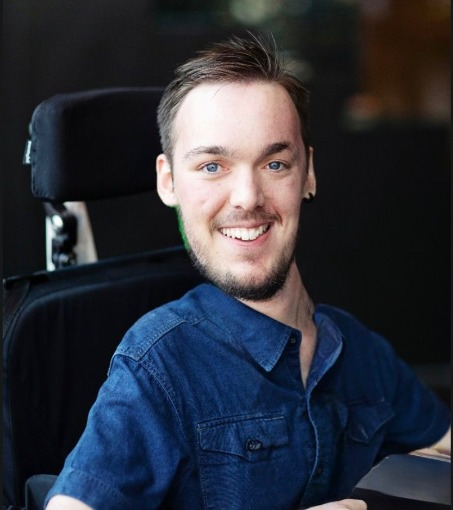

<html lang="de">
<head>
  <meta charset="utf-8">
  <meta name="viewport" content="width=device-width, initial-scale=1">
  <title>Joshua-Liam Kiesch</title>
  <meta name="description" content="Alle Links von Joshua-Liam Kiesch an einem Ort.">
  <meta name="theme-color" content="#0f1115">
  
</head>
<body>
  <main>
    <!-- Profilbild: Datei "foto.jpg" in denselben Ordner legen.
         Ohne Bild werden die Initialen angezeigt. -->
    

      JK
      
    

    <h1>Joshua-Liam Kiesch</h1>
    
Meine Links an einem Ort

    <nav class="links">
      <a class="link" href="https://www.instagram.com/joshslebenmitsma/" target="_blank" rel="noopener">
        <svg viewBox="0 0 24 24" fill="none" stroke="currentColor" stroke-width="2" stroke-linecap="round" stroke-linejoin="round"><rect x="3" y="3" width="18" height="18" rx="5"/><circle cx="12" cy="12" r="4"/><circle cx="17.5" cy="6.5" r="1" fill="currentColor" stroke="none"/></svg>
        Instagram
        <svg class="chevron" viewBox="0 0 24 24" fill="none" stroke="currentColor" stroke-width="2.5" stroke-linecap="round" stroke-linejoin="round"><path d="M9 6l6 6-6 6"/></svg>
      </a>

      <a class="link" href="https://www.tiktok.com/@joshua_kiesch" target="_blank" rel="noopener">
        <svg viewBox="0 0 24 24" fill="none" stroke="currentColor" stroke-width="2" stroke-linecap="round" stroke-linejoin="round"><path d="M14 3v11.5a3.5 3.5 0 1 1-3.5-3.5"/><path d="M14 3c.4 2.6 2.1 4.3 5 4.5"/></svg>
        TikTok
        <svg class="chevron" viewBox="0 0 24 24" fill="none" stroke="currentColor" stroke-width="2.5" stroke-linecap="round" stroke-linejoin="round"><path d="M9 6l6 6-6 6"/></svg>
      </a>

      <a class="link" href="https://www.facebook.com/joshualiam.kiesch" target="_blank" rel="noopener">
        <svg viewBox="0 0 24 24" fill="none" stroke="currentColor" stroke-width="2" stroke-linecap="round" stroke-linejoin="round"><circle cx="12" cy="12" r="9"/><path d="M13.5 21v-7.5h2.5l.5-3h-3V9c0-.9.4-1.5 1.600-1.500H16.500V4.900C16 4.800 15.300 4.700 14.600 4.700c-2.200 0-3.600 1.300-3.600 3.700v2.100H8.500v3H11V21"/></svg>
        Facebook
        <svg class="chevron" viewBox="0 0 24 24" fill="none" stroke="currentColor" stroke-width="2.5" stroke-linecap="round" stroke-linejoin="round"><path d="M9 6l6 6-6 6"/></svg>
      </a>

      <a class="link" href="https://www.linkedin.com/in/joshua-liam-kiesch-833611426" target="_blank" rel="noopener">
        <svg viewBox="0 0 24 24" fill="none" stroke="currentColor" stroke-width="2" stroke-linecap="round" stroke-linejoin="round"><rect x="3" y="3" width="18" height="18" rx="3"/><path d="M8 10.500V16M8 7.500v.01M12 16v-5.500M12 13c0-1.700 1-2.500 2.300-2.500S16.500 11.300 16.500 13v3"/></svg>
        LinkedIn
        <svg class="chevron" viewBox="0 0 24 24" fill="none" stroke="currentColor" stroke-width="2.5" stroke-linecap="round" stroke-linejoin="round"><path d="M9 6l6 6-6 6"/></svg>
      </a>

      <a class="link" href="https://joshs-leben.de" target="_blank" rel="noopener">
        <svg viewBox="0 0 24 24" fill="none" stroke="currentColor" stroke-width="2" stroke-linecap="round" stroke-linejoin="round"><circle cx="12" cy="12" r="9"/><path d="M3 12h18M12 3c2.5 2.7 3.8 5.7 3.8 9s-1.3 6.3-3.8 9c-2.5-2.7-3.8-5.7-3.8-9S9.5 5.7 12 3z"/></svg>
        Webseite
        <svg class="chevron" viewBox="0 0 24 24" fill="none" stroke="currentColor" stroke-width="2.5" stroke-linecap="round" stroke-linejoin="round"><path d="M9 6l6 6-6 6"/></svg>
      </a>
    </nav>

    <footer>&copy; Joshua-Liam Kiesch</footer>
  </main>
</body>
</html>
